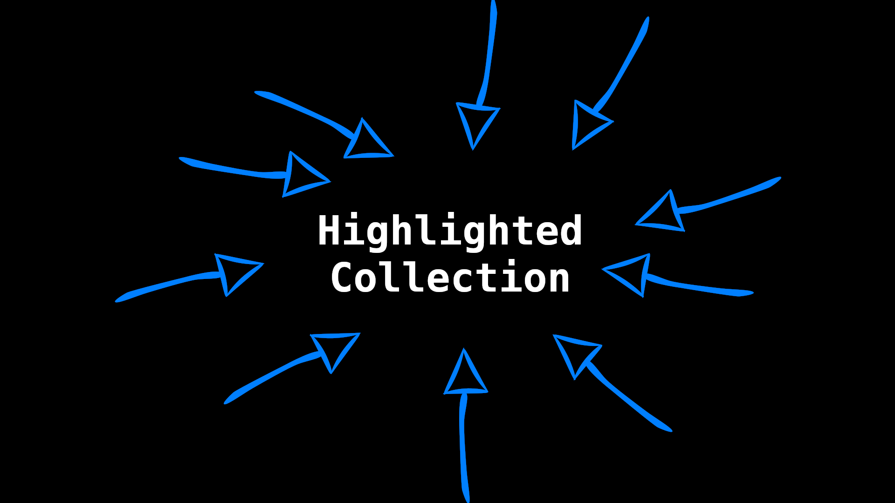
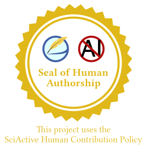
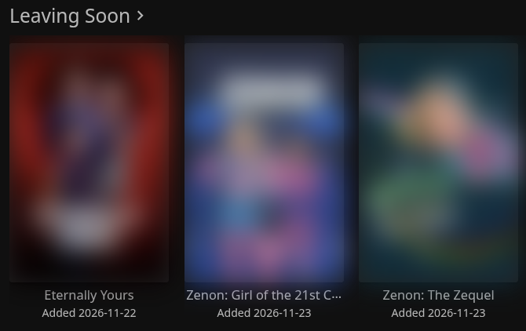
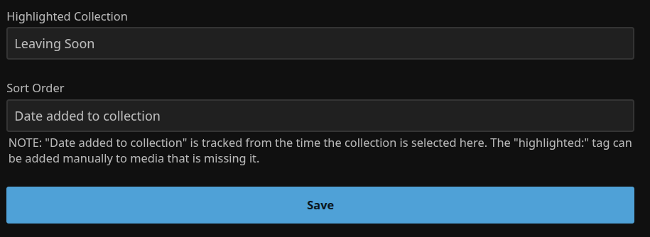

 

# Jellyfin Plugin: Highlighted Collection
Highlight any collection to add to your home page, such as a Leaving Soon collection.
You can set the ordering to work for your use case.
This is intended to be a temporary fix, just until Jellyfin supports this natively, which is theoretically coming eventually.

## Previews



## Settings
The settings for this plugin are straightforward:
- Highlighted Collection: this is the collection you want to appear at the top of your home screen for your users.
- Sort Order: this is the order in which to sort the items in the collection.  The first 16 items will appear, and the rest can be accessed by clicking on the section header.
  - Jellyfin default: does not force an ordering; renders in the order returned by Jellyfin.  (This appears to currently be in ascending PremiereDate.)
  - Date added to collection: the plugin tracks the date items are added to the selected collection using a tag that starts witih **highlighted:**; using this ordering will go in ascending order.  This is particularly useful for a leaving soon collection.  (Note: the plugin only manages this tag for the selected collection, and it can only do so after it's installed.  There's no native data to support this.)
  - Name (SortName): alphabetical by SortName (which is slightly different than Name by default in order to make sorting more predictable).

## Required Plugins
**This plugin _requires_ [JavaScript Injector by n00bcodr](https://github.com/n00bcodr/Jellyfin-JavaScript-Injector) to be installed in order to function.**  The JavaScript used to render the collection on the home screen is registered with, and injected by, JavaScript Injector.

## Install
Add the `cinderblockgames Plugins` repository to Jellyfin by going to the admin **Dashboard** > **Plugins** > **Manage Repositories** > **+ New Repository** using the following Repository URL:
```
https://raw.githubusercontent.com/cinderblockgames/jellyfin-plugins/refs/heads/main/manifest.json
```
Then return to **Plugins** and install **Highlighted Collection** on the **All** or **Available** tab.

## Justification Note
My hope is that Jellyfin will support this natively sooner rather than later.  It's [been discussed](https://github.com/jellyfin/jellyfin-meta/discussions/93) for a while, and it looks like it's planned, but there's definitely no timeline for it.

## Contributing
Contributions [adhering to the contribution policy](CONTRIBUTING.md) are welcome.  Especially if you can make the JavaScript more consistent.
